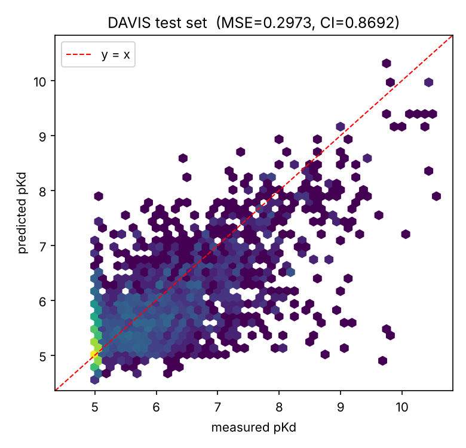
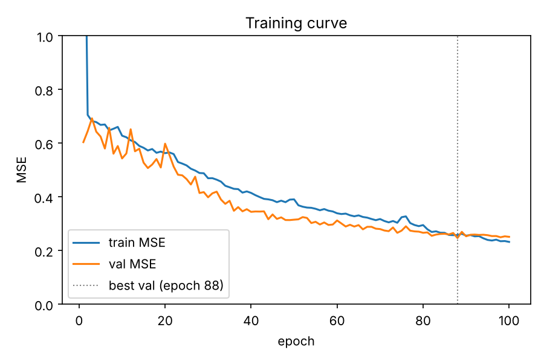

# Drug–target interaction prediction with a graph neural network

Predicts how strongly a drug binds a protein target. Each drug is turned into a molecular
graph with RDKit and passed through a GIN encoder; the target's amino-acid sequence goes
through a 1D CNN; the two embeddings are joined and an MLP predicts binding affinity
(pKd). Trained and evaluated on the **DAVIS** kinase dataset.



## Results

Trained for 100 epochs on CPU (early-stopped; best validation at epoch 88), evaluated on
the held-out DeepDTA test fold of **5,010 drug–target pairs**:

| metric | this model | GraphDTA paper (GIN) | DeepDTA paper |
|---|---|---|---|
| MSE | **0.297** | 0.229 | 0.261 |
| Concordance index (CI) | **0.869** | 0.893 | 0.878 |
| Pearson r | **0.793** | – | – |
| r_m² | **0.623** | – | – |
| RMSE | **0.545** | – | – |

Lower MSE is better; higher CI is better. The published numbers are there for context —
this model lands a bit short of them, which is what I'd expect given it trained for 100
epochs on 2 CPU cores rather than the much longer GPU runs in those papers. The shape of
the result is right: the model orders pairs well (CI 0.87) and the error is dominated by
the large spike of non-binders at pKd = 5.



Train and validation curves track each other closely with no divergence, so the model
isn't overfitting — it would likely keep improving with a longer run.

All numbers come from `results/metrics.json`, written by the training script; raw test
predictions are in `results/test_predictions.npz` if you want to recompute them.

## The dataset

**DAVIS** (Davis et al. 2011) screened 68 kinase inhibitors against 442 kinases, giving a
dense 68 × 442 grid of dissociation constants. Following DeepDTA, affinity is modelled as

```
pKd = -log10(Kd / 1e9)
```

so stronger binding means a larger number. Kd was capped at 10,000 nM for pairs that
didn't bind, which maps to pKd = 5 — and that's about **70% of the dataset**, which is why
the scatter plot has a dense column at 5 and why MSE alone is a misleading metric here (CI
and r_m² are the ones to watch).

Splits are the standard **fold setting 1** files from the DeepDTA repository: 25,046
training pairs and 5,010 test pairs, so the numbers above are comparable to published ones.

## How the model works

**Drug side.** `smiles_to_graph` parses the SMILES with RDKit and builds a graph where
nodes are atoms. Each atom gets a 31-dimensional feature vector — one-hot element, degree,
attached hydrogens, hybridisation, plus formal charge, aromaticity and ring membership.
Bonds become edges in both directions so message passing is symmetric. Three **GIN**
layers (chosen because GIN is the most expressive of the standard message-passing variants
for distinguishing graph structures) with batch norm and dropout, then mean pooling over
atoms gives one vector per drug.

**Protein side.** The sequence is encoded as amino-acid indices, truncated/padded to 1,000
residues, embedded, then passed through three 1D convolutions with max-pooling between the
first two. The pooling is deliberate: a binding motif is short relative to a 1,000-residue
kinase, so downsampling keeps the signal while making the wider later convolutions far
cheaper — it roughly halved my epoch time.

**Head.** The two 128-d embeddings are concatenated and run through a 3-layer MLP to a
single pKd. 480,705 parameters in total.

This follows the design of **GraphDTA** (Nguyen et al. 2021, *Bioinformatics*), written
from scratch here rather than adapted from their code.

## Running it

```bash
pip install -r requirements.txt

# get the DAVIS files from the DeepDTA repo
mkdir -p data/davis && cd data/davis
B=https://raw.githubusercontent.com/hkmztrk/DeepDTA/master/data/davis
curl -O $B/ligands_can.txt -O $B/proteins.txt -O $B/Y
curl -O $B/folds/train_fold_setting1.txt -O $B/folds/test_fold_setting1.txt
cd ../..

python scripts/train.py --epochs 200      # graphs are built and cached on first run
python scripts/evaluate.py                # writes the two figures
pytest
```

Training runs on CPU; it picks up a GPU automatically if one is available. On 2 CPU cores
an epoch takes about a minute. If you need to stop and resume, `--max-seconds N` writes a
checkpoint and `--resume` picks it up — which is how the run above was done.

## Layout

```
dti/
  data.py      DAVIS loading, SMILES -> graph, protein encoding
  model.py     GIN drug encoder + CNN protein encoder + MLP head
  metrics.py   MSE, RMSE, Pearson, concordance index, r_m^2
scripts/
  train.py     training loop with early stopping and resumable checkpoints
  evaluate.py  figures from a finished run
tests/         16 tests covering graph conversion, the model and the metrics
results/       metrics.json, history.json, predictions, trained weights
```

## Notes and limitations

- **The split is random over pairs**, which is the standard DAVIS benchmark but an easy
  one: nearly every drug and every target is seen during training. A cold-start split
  (unseen drugs or unseen targets) is much harder and a more honest test of generalisation.
  That's the first thing I'd add.
- **DAVIS is kinases only**, so nothing here should be read as a general binding predictor.
- The protein encoder treats the sequence as 1D text. It has no structural information —
  contact maps or embeddings from a protein language model would almost certainly help.
- 70% of labels sit at the pKd = 5 censoring floor. Treating those as exact values is the
  standard approach but it isn't really correct; they're left-censored measurements.

## References

- Davis et al. (2011) *Comprehensive analysis of kinase inhibitor selectivity.* Nat Biotechnol.
- Öztürk et al. (2018) *DeepDTA: deep drug–target binding affinity prediction.* Bioinformatics.
- Nguyen et al. (2021) *GraphDTA: predicting drug–target binding affinity with graph neural networks.* Bioinformatics.
